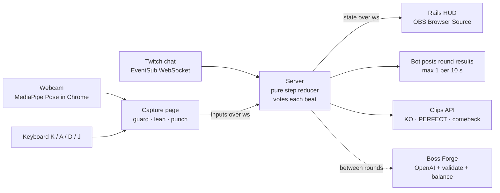

<p align="center"></p>

<h3 align="center">Twitch chat is the boss's brain. Your body is the defence.</h3>

<p align="center">Chat votes the boss's next attack; you choose the difficulty. You block with your hands and dodge with a lean, on webcam, live.</p>

<p align="center">
  <a href="https://streamervschat.kashifnazir.com"><b>Play now, no login</b></a> ·
  <a href="https://streamervschat.kashifnazir.com/play"><b>Try it on your channel</b></a> ·
  <a href="[VIDEO_URL]"><b>3-min demo</b></a> ·
  <a href="[DEVPOST_URL]"><b>Devpost</b></a>
</p>

<p align="center"></p>

**Codex × TwitchCon Hackathon** · directed by Kash · 57 code commits in one main Codex thread, October 2026 · Codex session ID `01a17e04-f4f0-7d12-ac96-ff47bf3cc88f` · from 31 October, after the Codex weekly limit ran out, 16 fixes and the docs by Claude Code (every commit labelled)

**Built with** OpenAI Codex · Twitch EventSub, Helix and Clips (Twurple) · MediaPipe Pose Landmarker · Node 22 + TypeScript · OBS · Cloudflare Workers

Chat runs the boss and the streamer has to physically survive it: viewers vote each attack, and the streamer guards and leans on webcam. The game scouts both sides: it tells chat "DODGES LEFT 83%" and tells the streamer what chat keeps voting, so chat stops spamming and starts coaching. One viewer is enough. In our framing: unlike Twitch Plays-style games (chat controls the game) or Crowd Control (chat triggers effects in someone else's game), here chat is the opponent's brain and the streamer's body is the controller, and both sides scout each other.

| Headline result | |
|---|---|
| Offline tests (unit, golden vectors, pose clips, transports) · **MEASURED**, `npm test` | **1,029**, no Twitch or external network (31 October 2026, fresh clone at `74cc38d`) |
| Simulated 1,000-chatter load, ingest to HUD · **MEASURED** 28 October, `npm run load` | **p95 104 ms**, 12 ms worst beat drift, 0 dropped votes ([LOAD.md](docs/LOAD.md)) |
| Golden vectors through the shared reducer, in `npm test` | **59** ([golden vectors](test/engine/golden.test.ts)) |
| 30-minute soak, server heap growth after warm-up · **MEASURED** 28 October, `npm run soak -- --minutes 30` | **+6.3182%** (gate under 20%) |
| Balance gate (casual 30–70%, no-punch ≥30%; ordinary/coordinated R1/R2 at 0 / 3 / 50 / 500 viewers) · **INFERRED** player models, `npm run sim` | **all PASS** |
| Medium casual / no-punch win rates, difficulty table (ordinary round 1), 0 to 500 viewers · **INFERRED** difficulty model | **66.1–70.1% / 50.4–54.6%** |
| Hard casual / no-punch win rates, four ordinary/coordinated R1/R2 matrices · **INFERRED** player models | **54.7–70.0% / 39.7–57.4%** |

**Kept out of the table.** Real live Twitch chat to server: **p50 218 ms / p95 291 ms**, **MEASURED** on Kash's Mac in the prep spike before this repo existed (not rerunnable from this repo; [recorded in the kickoff prompt](docs/prompts/day0-kickoff.txt)). End-to-end browser suites at `74cc38d` (demo flows 8/8, mocked `/play` journey 9/9, a11y at 6 widths in Chromium and WebKit, Lighthouse accessibility 100 on `/` and `/play`): run by the team outside this repo; not included. Their 10 bugs are among the [Claude Code fixes](#fixes-made-with-claude-code).

### Judging criteria → evidence

| Criterion | Claim | Evidence |
|---|---|---|
| **Innovation** | Chat and streamer scout each other: chat sees the streamer's dodge habit, the streamer sees chat's favourite move. Our framing of prior art: Twitch Plays-style games let chat control the game and Crowd Control lets chat trigger effects in someone else's game; here chat is the opponent's brain and the streamer's body the controller. | [scouting tests](test/engine/scouting.test.ts), [two-way tests](test/engine/two-way.test.ts), [SPEC](SPEC.md), [two-way review](docs/queue11a-review.md) |
| **Potential impact** | Works with one viewer; balance gated from 0 to 500 simulated viewers. OBS, or an experimental go-live-from-the-page shortcut. Every real Twitch session changed the game. | [Real playtests](#real-playtests), [crowd tests](test/engine/crowd.test.ts), [LOAD.md](docs/LOAD.md), [Go live code](demo/src/go-live.ts) |
| **Technical implementation + Codex** | One pure reducer shared by server, sim, demo and `/play`; MediaPipe pose with per-user calibration, lean thresholds tuned on Kash's recorded clip; EventSub; experimental WHIP go-live; 1,029 offline tests; 57 code commits in one Codex thread, then 16 labelled Claude Code fixes | [engine](shared/src/engine.ts), [golden vectors](test/engine/golden.test.ts), [shallow-lean replay test](test/pose/shallow-lean.test.ts), [deep-lean gate test](test/pose/deep-lean-gate.test.ts), [Codex evidence](docs/codex-evidence.md), [AGENTS.md](AGENTS.md) |
| **Design** | Each warning names the defence (GUARD! / LEAN LEFT! / LEAN RIGHT!) → a real block in 1.0 s on Medium; four difficulty levels, webcam starting on Easy (1.2 s); one main button per setup step; keyboard, seated and no-punch modes; no-login demo | [no-login demo](https://streamervschat.kashifnazir.com), [callout tests](overlay/src/hud-callout.test.ts), [webcam difficulty tests](demo/src/webcam-difficulty.test.ts), [HUD.md](docs/HUD.md), [day 6 review](docs/day6-review.md) |

## How to play

Chat Golem commands (first word, case-insensitive): **!jab (!j)** = guard; **!left (!l)** = hook from the left → **you lean right**; **!right (!r)** = hook from the right → **you lean left**; **!combo (!c)** = guard; **!super (!s)** = follow all three displayed GUARD / LEAN steps, only at full hype. Custom Forge bosses use exactly their displayed commands. Keyboard K / A / D / J controls the streamer.

### Try it in a few clicks

1. Open **[streamervschat.kashifnazir.com](https://streamervschat.kashifnazir.com)**: no account, no install.
2. Press **PLAY NOW · KEYBOARD** and practise **K → A → J** (or **K → A → D** in **Defence only**). Medium by default; **Options** offers Easy / Hard / Expert. **Use my webcam instead** adds calibration and a clear-space tick and starts on **Easy** (1.2 s warning) unless you picked a level. **Esc Pause** opens Resume / Restart / Quit to setup.
3. Simulated chat (badged **SIMULATED**) plays the boss. The warning names the defence (**GUARD!**, **LEAN RIGHT!** or **LEAN LEFT!**; TILT when seated) and you have 1.0 s on Medium (Hard keeps the original 0.8 s). Clean defences fill **FOCUS**; at **FINISHER READY**, hold **K** for **1 s** between attacks: **4 damage**, then **3 s** of double-damage punches.
4. **[See the scouting card in one round](https://streamervschat.kashifnazir.com/?scout=fast)** (demo-only **SCOUT PREVIEW · SIMULATED** preset; keep dodging to the same side). Normal play reveals it from round 2, once there is enough evidence (at least 12 successful dodge leans plus share and confidence bounds); pre-hold the defence for chat's favourite move for +25% counter damage and **READ IT**.

Judges: [JUDGES.md](JUDGES.md) has a 90-second path, a five-minute tour, what is live versus simulated, and the known limits.

### Stream it on your channel

Open **[/play in Chrome](https://streamervschat.kashifnazir.com/play)**, Connect Twitch, choose how to go live and how to defend: a few clicks. **Advanced (OBS)** is the documented path. **Quick (no OBS)** is an experimental shortcut that streams this Chrome tab through Twitch's undocumented WHIP ingest. **MEASURED 31 Oct:** Kash's prep test received HTTP 201, connected in under one second and appeared live on twitch.tv/kashruns; later that day the deployed app's own Go live was used live on kashruns and a viewer saw only the fight stage with the camera bubble (a pause bug seen in that run was then fixed in `3677761`). One account, not a guarantee; if Quick fails, use OBS. Details: [docs/HOSTED.md](docs/HOSTED.md#going-live-from-the-page-experimental).

## Why it's different

- **Body as controller, only where it's reliable.** Guard and lean decide every hit; punches are bonus damage, because punch detection on unseen people was much less reliable.
- **Safe on stream.** A clear-space check before every match; Esc / STOP or the broadcaster typing "stop" freezes play; mods can `!pause` or `!veto`; `!forgetme` deletes a viewer's record.

## How it works



The same pure `step(state, event, now)` reducer runs in the local server, the balance sim, the no-login demo and hosted `/play`, so what judges play is what streamers run. Locally the server owns state; the demo and `/play` own it in the browser.

Live versus simulated, mode by mode: [JUDGES.md](JUDGES.md#1-whats-live-and-whats-simulated).

### Hosted backend

A Cloudflare Worker backs `/play`: a bot posts round results (never with the streamer's token), clips appear only once Twitch confirms them, Boss Forge has daily caps, and opt-in viewer memory never stores chat text. Every hosted flag is committed off and turned on in the deployed Worker. On 31 October bot results, clips and Boss Forge were deployed but **not yet checked live in this build**; sound on stream (OBS audio) is **not yet confirmed live**. Permissions, token storage, bot and clip rules, privacy and the status table: [docs/HOSTED.md](docs/HOSTED.md).

## Results

Balance comes from the final `npm run sim` at `0be805d` (4,000 rounds per cell); the output at `74cc38d` is identical. Every balance number is **INFERRED** from assumed player models, not measured human win rates. Per-viewer win rates for all four levels: [SPEC difficulty results](SPEC.md#13-difficulty-levels). How each number is produced and rerun: [Tests and balance](#tests-and-balance), [LOAD.md](docs/LOAD.md), [Ship review](docs/queue13e-review.md).

## Real playtests

No wider playtest happened (no time). Real people only, raw counts.

- **Session 1 (29 October, kashruns, 1 viewer typing):** real chat reached the game and the bot posted every round result. The pace was too fast to move to, so Codex added four difficulty levels and an obvious INPUTS LOCKED banner (`19830f9`…`beb1e3d`).
- **Session 2 (29 October, same viewer, 14 commands):** hits on the boss weren't obvious, `!hookl` was hard to type and nobody knew what `!super` did. Codex added one-letter commands and `!left`/`!right`, clear hit feedback, SUPER as a visible 3-step sequence and a FOCUS → FINISHER meter (`e76b693`…`0be805d`).
- **Session 3 (31 October):** planned; not run yet at the time of writing.
- **Setup session (31 October):** Kash's own setup on kashruns surfaced login-landing, webcam-start and OBS friction, which the last Codex turns fixed, and led to going live straight from the page (see [Stream it on your channel](#stream-it-on-your-channel)).

## Run it locally

Needs Node **22.12+**, npm and Chrome; the Twitch steps also need the [Twitch CLI](https://dev.twitch.tv/docs/cli/).

```sh
npm ci
npm run demo          # no-login demo on http://localhost:4173, no keys, no network
npm run dev:mock      # stop demo first; full stack with local mocked Twitch
```

Your own live channel (`.env`, Twitch app, bot and broadcaster accounts, `/capture`, the OBS overlay): [docs/DEVELOPMENT.md](docs/DEVELOPMENT.md).

### Tests and balance

```sh
npm test              # offline; never calls Twitch or OpenAI
npm run sim           # balance gate, 4,000 rounds per cell
npx tsc --noEmit
npm run build:demo    # static no-login build in dist-demo/
```

GitHub Actions runs all four plus a two-minute local soak on every push. `npm run load` and `npm run soak` also need the Twitch CLI and free local ports ([LOAD.md](docs/LOAD.md)).

## Boss Forge

In the demo, open **Boss Forge**, pick one of four prebaked bosses (Neon Kraken, Tin Tactician, Velvet Sentinel or **Nak Muay**) and press **Test this boss**; no key needed. Live, chat sends `!forge <idea>` (endorse with `!forge +1`) and a mod sends plain `!forge` between rounds (or `!veto`); the server asks OpenAI (`gpt-6-luna`, one repair turn), then validation, moderation and the balance gate decide whether the boss fights. Ideas never reach the announcer's voice. [Hosted caps](docs/HOSTED.md#boss-forge-on-play) · [review](docs/boss-forge-review.md).

## How Codex built this

**Kash directed.** He set the direction and did all the camera, Twitch and physical testing. Briefs were drafted with Claude Code from his notes and approved by him, every one; Codex planned each task, split it into subagent lanes where useful, made the design calls inside the brief and wrote the code, in one main thread (`01a17e04-f4f0-7d12-ac96-ff47bf3cc88f`): 77 turns and 57 code commits, up to its last turn (`3677761`).

**Decisions Codex made inside the briefs** (prompt → commit → test):
1. **FINISHER retuned, gate untouched.** The brief asked for an 8-damage FINISHER. The balance gate rejected it (coordinated R2 casual 72.6% > 70%), so Codex lowered the damage step by step to 4, then cut the FOCUS gains from +15/+30 to +12/+24 until the cell passed at 69.98%, without loosening the gate ([balance review](docs/queue13g-review.md) → `0be805d` → [focus-finisher tests](test/engine/focus-finisher.test.ts)).
2. **CHAT SYNC dropped.** Two tuning attempts both failed the gate, so the feature was removed rather than the gate relaxed ([review](docs/queue11a-review.md) → `b311b51` → [two-way tests](test/engine/two-way.test.ts)).
3. **Lean-invariant guard.** Live tests showed the guard flickering while leaning, which on stream would drop every block. Codex made guard independent of shoulder tilt, with hysteresis ([day 2 prompt](docs/prompts/day2-pose.md) → `0c75cd7`, `3c7a268` → [recorded-clip replay tests](test/pose/replay.test.ts)).
4. **Resting hands are not a guard.** Hands at the waist read as guard, so a resting streamer blocked everything. Codex added an anatomical wrist/elbow/torso gate (`0f7707f`, then `3f638ae`).

**How each task ran.** Codex ran an **independent subagent review** before each commit (a few late small turns used Claude Code's fresh-clone and browser checks instead, to save budget). Claude Code queued each approved brief with `codex exec resume`, checked every result in a fresh clone and a real browser, and deployed; Devin also drafted prompts and reviewed results until 30 October. Two other Codex sessions (`01a17fb6-76f6-78f2-9c20-e7926e5aba23`, `01a17fb7-0a50-70b1-af8e-edcee261d14d`) were scratch probes of `codex exec resume` with no entry code. [AGENTS.md](AGENTS.md) holds the rules Codex followed.

In Kash's words:

> All of this was built on a Plus plan, and in the first iterations we burned through a load of credits I had from a previous OpenAI hackathon, and after that we used the weekly reset. There's only so much I'm able to do on a Plus account, so we tried to do as much as we can in Codex: 77 turns and 57 code commits in one thread.
>
> Near the end we had to be realistic if we wanted to get this finished. We were having to iterate quite a bit to fix problems that we kept seeing coming up in live tests, and so when the weekly limit ran out we finished it off with Claude Code (the last 16 fixes, listed below). Ideally I would have had a Pro Codex account to do this, and from doing this hackathon that's now something I want, because I really enjoyed working with Codex.

### Fixes made with Claude Code

16 commits after the last Codex turn (`git log --oneline | grep 'fix (Claude Code)'`), from live tests and the end-to-end suites, oldest first. **Size (MEASURED, `git diff --numstat 3677761 74cc38d`):** about 222 added lines of app code and 511 of tests (≈5% of the repo's 15,609 TypeScript/HTML/CSS lines); sim output identical and no golden vectors changed, so no gameplay rules changed.

- `7348cf2` remember the Twitch login on this computer until Disconnect
- `7f06308` warn before leaving a live or in-progress match
- `0ce1e42` no unstyled flash while Twitch login returns
- `b1c7b22` name the defence in each callout, quieter announcer, webcam SUPER prompts
- `4f3c5ef` deep leans no longer trip the punch gate (gate on shoulder-axis length)
- `7c71f02` lean threshold 48% of the calibrated peak, 170 ms dwell
- `8bbf47e` webcam countdown no longer steps the new fight back in time
- `e1bfd01` webcam players start on Easy unless they picked a level
- `4bfb1dc` pause dialog sits above the round results so Resume works between rounds
- `b3cac4d` match-end results no longer show "Next round in 0 s"
- `cb1f49b` show the rehearsal result and Rehearse button when the take ends
- `f62dd87` M mutes straight after clicking the Sound switch
- `ae39ec0` /play keeps the loading shell while a remembered login validates; says Connected after OAuth
- `503ffd3` Disconnect shows its notice on step 1, not a stale "Stream ended."; chat status drops "LIVE ·"
- `6cc03bf` a revoked or expired Twitch login mid-fight shows the Reconnect card, not a blank page
- `74cc38d` a11y pass: 24 px HUD targets in the demo, pause focus trap, webcam focus, touch-sized rows

**Webcam lean tuning (MEASURED by replaying Kash's recorded calibration clip, 31 October):** shallow leans registered 3/6 → **6/6**, fight-speed leans **16/16**, **0** false leans while relaxed or guarding (`7c71f02`, [shallow-lean test](test/pose/shallow-lean.test.ts)). A deep lean could trip the punch gate and never register; fixed in `4f3c5ef` ([deep-lean gate test](test/pose/deep-lean-gate.test.ts)).

**Evidence snapshot** (31 October 2026, `74cc38d`, from the real root rollout and git; [definitions and reproduction](docs/codex-evidence.md)): root turns started / completed **77 / 77** (54 with tools, 23 without); Plus plan, weekly limit about 94% used by the last Codex turn (`3677761`); **74** commits on `main` at `74cc38d` = 57 Codex + 16 "fix (Claude Code)" + 1 "docs (Claude Code)", later commits docs only; offline tests 19 on day 1 → **1,029**.

## Known limits

- **Punches are optional bonus damage**; no-punch mode keeps automatic defence counters.
- **Camera needs Chrome** (not the OBS Browser Source) and decent light; lost tracking releases held pose inputs. Webcam leans take about 0.4 s to register, so Easy is preselected for webcam play.
- **Hosted features sit behind flags** (committed off, on in the deployed site); cheers and subs need the local server; clips need a stream at least 60 seconds old.
- **Going live from the page is experimental** (undocumented WHIP ingest); OBS is the documented path.
- **Boss Forge needs an OpenAI key configured on the local server or hosted Worker**; it never asks a viewer for one. Tests use injected fake clients.

## More

- [SPEC.md](SPEC.md) (rules and numbers) · [docs/HUD.md](docs/HUD.md) (HUD layout) · [docs/HOSTED.md](docs/HOSTED.md) (hosted `/play`) · [docs/DEVELOPMENT.md](docs/DEVELOPMENT.md) (OBS, mock Twitch, live chat, highlights, viewer memory, hardening) · [CREDITS.md](CREDITS.md) (assets and licences).
- **Accessibility:** keyboard, seated and no-punch modes, a 36 px HUD font floor, 24 px demo HUD targets, a focus-trapped pause dialog, calm FX (`?fx=calm` or reduced motion) ([day 5](docs/day5-review.md), [day 6](docs/day6-review.md)).
- **What's next:** more fighting styles on the same guard/lean detection (Nak Muay already adds TEEP, elbows and CLINCH KNEES), other body-input games where chat sets the pattern, and a Twitch Extension so viewers vote by clicking.

## Licence

MIT for the code ([LICENSE](LICENSE)). Fonts, sounds, art and voice lines keep their own licences ([CREDITS.md](CREDITS.md), [sound notes](assets/SOUNDS.md), [voice notes](assets/voice/README.md), [boss art](assets/boss/README.md)).
