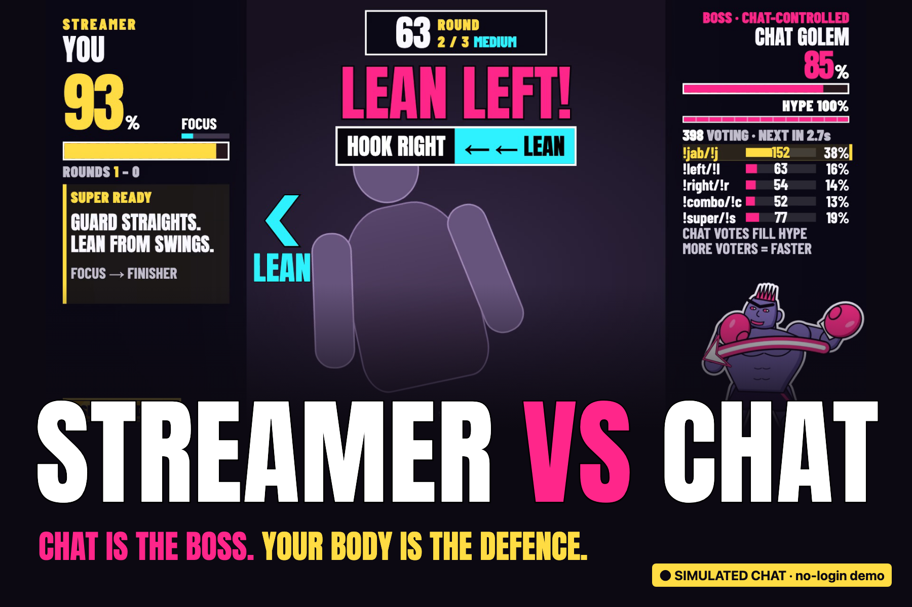
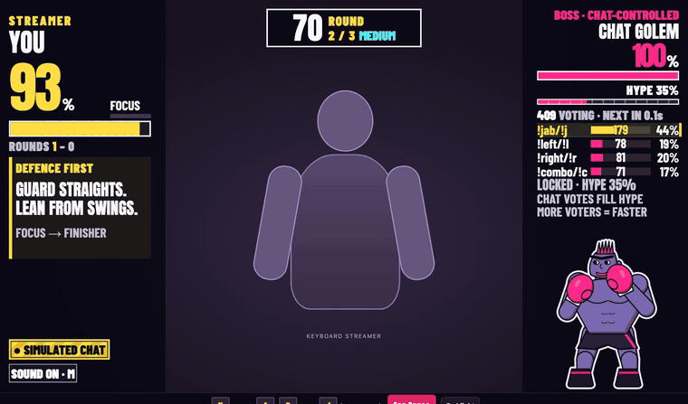
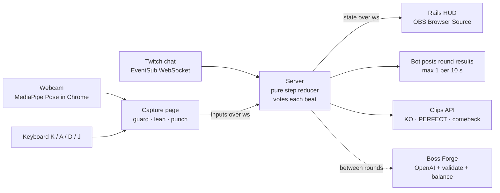

<p align="center"></p>

<h3 align="center">Twitch chat is the boss's brain. Your body is the defence.</h3>

<p align="center">Chat votes the boss's next attack; you choose the difficulty. You block with your hands and dodge with a lean, on webcam, live.</p>

<p align="center">
  <a href="https://streamervschat.kashifnazir.com"><b>Play now, no login</b></a> ·
  <a href="https://streamervschat.kashifnazir.com/play"><b>Try it on your channel</b></a> ·
  <a href="[VIDEO_URL]"><b>3-min demo</b></a> ·
  <a href="[DEVPOST_URL]"><b>Devpost</b></a>
</p>

<p align="center"></p>

**Codex × TwitchCon Hackathon** · directed by Kash · built mostly with OpenAI Codex on a Plus plan: 57 code commits in one main thread · Codex session ID `01a17e04-f4f0-7d12-ac96-ff47bf3cc88f` · finished with Claude Code from 31 October, once the Codex limits and credits were used up (every commit labelled; [measured split](#how-codex-built-this))

**Built with** OpenAI Codex · Twitch EventSub, Helix and Clips (Twurple) · MediaPipe Pose Landmarker · Node 22 + TypeScript · OBS · Cloudflare Workers

Chat runs the boss and the streamer has to physically survive it: viewers vote each attack, and the streamer guards and leans on webcam. The game scouts both sides: it tells chat "DODGES LEFT 83%" and tells the streamer what chat keeps voting, so chat stops spamming and starts coaching. One viewer is enough.

| Headline result | |
|---|---|
| Offline tests (unit, golden vectors, pose clips, transports) · **MEASURED**, `npm test` | **1,281** in 169 files, no Twitch or external network (2 November 2026, at `8c99b7e`) |
| Simulated 1,000-chatter load, ingest to HUD · **MEASURED** 28 October, `npm run load` | **p95 104 ms**, 12 ms worst beat drift, 0 dropped votes ([LOAD.md](docs/LOAD.md)) |
| Golden vectors through the shared reducer, in `npm test` | **59** ([golden vectors](test/engine/golden.test.ts)) |
| 30-minute soak, server heap growth after warm-up · **MEASURED** 28 October, `npm run soak -- --minutes 30` | **+6.3182%** (gate under 20%) |
| Balance gate (casual 30–70%, no-punch ≥30%; ordinary/coordinated R1/R2 at 0 / 3 / 50 / 500 viewers) · **INFERRED** player models, `npm run sim` | **all PASS** |
| Medium casual / no-punch win rates, difficulty table (ordinary round 1), 0 to 500 viewers · **INFERRED** difficulty model | **66.1–70.1% / 50.4–54.6%** |
| Hard casual / no-punch win rates, four ordinary/coordinated R1/R2 matrices · **INFERRED** player models | **54.7–70.0% / 39.7–57.4%** |

**Kept out of the table.** Live Twitch chat to server **p50 218 ms / p95 291 ms**, **MEASURED** in the prep spike, not rerunnable here ([kickoff prompt](docs/prompts/day0-kickoff.txt)). End-to-end browser checks are local Playwright runs outside this repo. **MEASURED** 1 November on the live build: 9 offline demo flows, 41 Crowd Trainer checks and 9 mocked `/play` steps pass. An earlier run at `74cc38d` (with a11y at 6 widths and Lighthouse accessibility 100) found 10 bugs, fixed among the [Claude Code commits](#finished-with-claude-code).

### Judging criteria → evidence

| Criterion | Claim | Evidence |
|---|---|---|
| **Innovation** | Chat and streamer scout each other: chat sees the streamer's dodge habit, the streamer sees chat's favourite move. Our framing of prior art: Twitch Plays-style games let chat control the game and Crowd Control lets chat trigger effects in someone else's game; here chat is the opponent's brain and the streamer's body the controller. | [scouting tests](test/engine/scouting.test.ts), [two-way tests](test/engine/two-way.test.ts), [SPEC](SPEC.md), [two-way review](docs/queue11a-review.md) |
| **Potential impact** | Works with one viewer; balance gated from 0 to 500 simulated viewers. OBS, or an experimental go-live-from-the-page shortcut. Every real Twitch session changed the game. | [Real playtests](#real-playtests), [crowd tests](test/engine/crowd.test.ts), [LOAD.md](docs/LOAD.md), [Go live code](demo/src/go-live.ts) |
| **Technical implementation + Codex** | One pure reducer shared by server, sim, demo and `/play`; MediaPipe pose with per-user calibration, lean thresholds tuned on Kash's recorded clip; EventSub; experimental WHIP go-live; 1,281 offline tests; 57 code commits in one Codex thread, then labelled Claude Code commits ([measured split](#how-codex-built-this)) | [engine](shared/src/engine.ts), [golden vectors](test/engine/golden.test.ts), [webcam evidence](docs/WEBCAM.md), [Codex evidence](docs/codex-evidence.md), [AGENTS.md](AGENTS.md) |
| **Design** | Each warning names the defence (GUARD! / LEAN LEFT! / LEAN RIGHT!) → a real block in 1.0 s on Medium; four difficulty levels, webcam starting on Easy (1.2 s); one main button per setup step; keyboard, seated and no-punch modes; no-login demo | [no-login demo](https://streamervschat.kashifnazir.com), [callout tests](overlay/src/hud-callout.test.ts), [webcam difficulty tests](demo/src/webcam-difficulty.test.ts), [HUD.md](docs/HUD.md), [day 6 review](docs/day6-review.md) |

## How to play

Two ways to play: **Boss Fight** (chat votes the boss's attacks, you defend) or **Crowd Trainer** (chat votes the combo you throw, like a boxing class calling numbers).

**Boss Fight.** Chat Golem commands (first word, case-insensitive): **!jab (!j)** = guard; **!left (!l)** = hook from the left → **you lean right**; **!right (!r)** = hook from the right → **you lean left**; **!combo (!c)** = guard; **!super (!s)** = follow all three displayed GUARD / LEAN steps, only at full hype. Custom Forge bosses use exactly their displayed commands. Keyboard K / A / D / J controls the streamer.

### Try it in a few clicks

1. Open **[streamervschat.kashifnazir.com](https://streamervschat.kashifnazir.com)**: no account, no install. The big **PLAY ON YOUR TWITCH STREAM** button is the real game (`/play`: connect Twitch, go live, viewers vote in chat). The **Try it now · fake chat, no login** box under it is the demo.
2. In **Try it now**, pick **Webcam** (the default on a computer; it starts on **Easy**, 1.2 s warning) or **Keyboard** (the fallback, and the default on a phone; Medium), then press **TRY THE DEMO**. Webcam setup takes about 30 s in 5 steps: get in frame, guard up, lean left, lean right, then an optional punch with each hand (**Skip punches** is fine). The camera works straight away; tick **My space is clear** before **START WEBCAM FIGHT**. On the keyboard, the practice is **K** (guard), then **A** and **D** (lean both ways), then **J** (punch); in **Defence only** it is **K → A → D**. **Options** offers Easy / Medium / Hard / Expert. **Esc** pauses; browser **Back** pauses too, and Back again returns to the homepage.
3. Simulated chat plays the boss. A **SIMULATED CHAT** panel shows the fake viewers' votes and the bot's result line. The warning names the defence (**GUARD!**, **LEAN RIGHT!** or **LEAN LEFT!**; TILT when seated) and you have 1.0 s on Medium. Clean defences fill **FOCUS**; at **FINISHER READY**, hold **K** for **1 s** between attacks: **4 damage**, then **3 s** of double-damage punches. A knocked-out boss greys out under a **K.O.** stamp. After 1.5 s a scoreboard card shows the round score, your stats and a **Chat MVP · SIMULATED**. The next round waits until you press **NEXT ROUND** (no timer).
4. **[See the scouting card in one round](https://streamervschat.kashifnazir.com/?scout=fast)** (demo-only, badged **SCOUT PREVIEW · SIMULATED**; keep dodging to one side). Normally it shows from round 2, once there is enough evidence; pre-hold the defence for chat's favourite move for +25% counter damage and **READ IT**.

### Crowd Trainer

Open **[?mode=trainer](https://streamervschat.kashifnazir.com/?mode=trainer)**. Chat votes the next combo: `!12` (one-two), `!112`, `!121`, `!1212`, `!12s` (one-two, slip), `!s12`, `!12g` (one-two, guard), `!2s2`; `!faster` / `!slower` set the pace. **1** = left (lead) hand, **2** = right (rear), **S** = slip (lean), **G** = guard. On the keyboard press the same keys (**1**, **2**, **S**, hold **G**) or **F**, **J**, **A/D**, hold **K**. A **Your keys** card before round 1 asks you to press each move once (or Skip); on webcam, click **I'm ready** or hold your guard for 1 s. Each combo chip shows its key (or the move, on webcam). With sound on, a recorded coach voice calls each combo. Three 60 s rounds, 20 s rest, lenient scoring (**CLEAN / PARTIAL / MISSED**), **Southpaw** and **any hand counts** options, and a workout summary (no calorie or medical claims).

**Who it's for:** fitness and boxing or martial-arts streamers, and any streamer who wants chat to be part of a workout.

Judges: [JUDGES.md](JUDGES.md) has a 90-second path, a 60-second Crowd Trainer path, a five-minute tour, what is live versus simulated, and the known limits.

### Stream it on your channel

Open **[/play in Chrome](https://streamervschat.kashifnazir.com/play)**. Step 1 says what Twitch will ask for and why, then **Connect Twitch**. Step 2 is going live. Step 3 picks the game mode first (Boss Fight or Crowd Trainer), then how you defend, then a **What your stream gets** row: bot results in chat, clips, remember my viewers and Boss Forge. During a fight the page shows only the fight. Each end button has one job: **End fight**, **End stream** (the page's own broadcast) and **Finish & copy results** (the session). Clips are requested 6 s after a KO or PERFECT, one per burst, with a title. **Advanced (OBS)** is the documented path. **Quick (no OBS)** is an experimental shortcut that streams this Chrome tab through Twitch's undocumented WHIP ingest: **MEASURED** working live on twitch.tv/kashruns on 31 October (one account, not a guarantee; if it fails, use OBS). Details: [docs/HOSTED.md](docs/HOSTED.md#going-live-from-the-page-experimental).

## Why it's different

- **Body as controller, only where it's reliable.** Guard and lean decide every hit; punches are bonus damage, because punch detection on unseen people was much less reliable.
- **Safe on stream.** A clear-space check before every match; Esc / STOP or the broadcaster typing "stop" freezes play; mods can `!pause` or `!veto`; `!forgetme` deletes a viewer's record.

## What the webcam can and can't see

Anyone should be able to play with what they already have: one ordinary webcam in Chrome. No gloves, wrist trackers, heart-rate straps, VR, Kinect or depth camera. Pose runs in the browser (MediaPipe Pose Landmarker lite, CPU, model served by the site). Frames go only to that local model, never to a server; video leaves the computer only if the streamer goes live, and then only to Twitch. Keyboard, seated and no-punch modes cover anyone who can't or won't use a camera or punch.

| Reads reliably | Can't read reliably |
|---|---|
| **Guard**, with hysteresis so it holds through leans: 100% of held frames on Kash's webcam (**MEASURED**, prep spike) | **Punch type** (jab, hook, uppercut): a front camera can't see depth |
| **Lean**: 48% of your calibrated peak, held 170 ms. Shallow leans 3/6 → **6/6**, fight-speed **16/16**, **0** false leans relaxed or guarding (**MEASURED**, Kash's recorded clip, [test](test/pose/shallow-lean.test.ts)) | **Punch force and speed**; **footwork, kicks**, legs out of frame; **low light**; people outside the frame |
| **Straight punches, which hand**: **42 of 44** of Kash's recorded punches caught, 7 false punches over guard, lean and slip footage, and 51 of 59 in their 2 November fast one-two drills; the old rule caught 13 with 30 false (**MEASURED**, [test](test/pose/straight-punch.test.ts)) | **Punches on unseen people**: recall 0.33–0.55 in the prep spikes; in-repo Pexels clips 17/21 punches toward the camera but 2/11 side-on hooks (**MEASURED**) |

So defence decides the fight, punches are bonus, and Crowd Trainer scores leniently on hand, slip and guard only. Evidence, the code privacy check and what better hardware could add: [docs/WEBCAM.md](docs/WEBCAM.md).

## How it works



The same pure `step(state, event, now)` reducer runs in the local server, the balance sim, the no-login demo and hosted `/play`, so what judges play is what streamers run.

Live versus simulated: [JUDGES.md](JUDGES.md#1-whats-live-and-whats-simulated).

### Hosted backend

A Cloudflare Worker backs `/play`: bot round results (never with the streamer's token), clips only once Twitch confirms them, capped Boss Forge, and opt-in viewer memory that never stores chat text. Flags are committed off and on in the deployed Worker. Live status on 1 November: clips were made on Kash's channel (before the new 6 s wait, which is not yet checked live); the bot's result line failed to post (a request failure, still open); Forge and sound on stream are **not yet checked live in this build**. A voice corner coach (ElevenLabs) is built but **switched off for the submission**; its code is kept ([docs/COACH.md](docs/COACH.md)). Details and status: [docs/HOSTED.md](docs/HOSTED.md).

## Real playtests

No wider playtest happened (no time). Real people only, raw counts.

- **Session 1 (29 October, kashruns, 1 viewer typing):** real chat reached the game and the bot posted every round result. Too fast to move to, so Codex added four difficulty levels and an INPUTS LOCKED banner (`19830f9`…`beb1e3d`).
- **Session 2 (29 October, same viewer, 14 commands):** hits on the boss weren't obvious, `!hookl` was hard to type and nobody knew what `!super` did. Codex added one-letter commands and `!left`/`!right`, clear hit feedback, SUPER as a visible 3-step sequence and a FOCUS → FINISHER meter (`e76b693`…`0be805d`).
- **Session 3 (with a viewer):** planned; not run at the time of writing.
- **Kash's own live tests (1 November):** led to the 5-step webcam setup, the straight-punch detector, the scoreboard results card and clips that wait for the KO. The bot's result line failed to post (still open).
- **Setup session (31 October):** Kash's own setup surfaced login, webcam-start and OBS friction, fixed in the last Codex turns, and led to [going live from the page](#stream-it-on-your-channel).

## Run it locally

Needs Node **22.12+**, npm and Chrome; the Twitch steps also need the [Twitch CLI](https://dev.twitch.tv/docs/cli/).

```sh
npm ci
npm run demo          # no-login demo on http://localhost:4173, no keys, no network
npm run dev:mock      # stop demo first; full stack with local mocked Twitch
```

Your own live channel (`.env`, Twitch app, bot and broadcaster accounts, `/capture`, the OBS overlay): [docs/DEVELOPMENT.md](docs/DEVELOPMENT.md).

### Tests and balance

```sh
npm test              # offline; never calls Twitch or OpenAI
npm run sim           # balance gate, 4,000 rounds per cell
npx tsc --noEmit
npm run build:demo    # static no-login build in dist-demo/
```

GitHub Actions runs all four plus a two-minute local soak on every push. Balance numbers come from `0be805d` (sim output identical at `ee1a6e2`) and are **INFERRED** from assumed player models, not human win rates ([SPEC](SPEC.md#13-difficulty-levels), [ship review](docs/queue13e-review.md)). `npm run load` and `npm run soak` also need the Twitch CLI and free local ports ([LOAD.md](docs/LOAD.md)).

## Boss Forge

Boss Forge runs on `/play`: chat sends `!forge <idea>` (`!forge +1` to endorse) and a mod sends plain `!forge` between rounds; OpenAI (`gpt-6-luna`) drafts a boss, then validation, moderation and the balance gate decide whether it fights. Ideas never reach the announcer's voice. [Hosted caps](docs/HOSTED.md#boss-forge-on-play) · [review](docs/boss-forge-review.md).

## How Codex built this

**Built mostly with Codex, in one thread, on a Plus plan.** Kash directed and did all the camera, Twitch and physical testing, and approved every brief (drafted with Claude Code). Codex planned each task, split it into subagent lanes where useful, made the design calls inside the brief and wrote the code, in one main thread: 77 turns and 57 code commits, 27 to 31 October, up to its last turn, 13w (`3677761`).

**Staying in Codex.** Early turns used credits left from a previous OpenAI hackathon. After that, at each usage limit Kash waited for the reset and sent a short continue into the same thread, some scheduled ([dated timeline](docs/codex-evidence.md#usage-limits-and-continues)). By 31 October the build had used up the Plus weekly limit (about 94% by 13w), both limit resets that fell in the Submission Period (25 and 29 October) and the extra credits left from a previous OpenAI hackathon ([plan usage](docs/codex-evidence.md#plan-usage-page-kashs-screenshots-1-nov)). On 1 November the panel showed 4% left, resetting 5 November, after the deadline ([screenshot](docs/img/codex-limit-1nov.png)). There were no Codex turns after 13w.

**Finished with Claude Code.** To meet the deadline, Claude Code finished the entry from 31 October. On 31 October and overnight that was polish and bug fixes from live tests. On 1 November it was bigger: the Crowd Trainer mode, the recorded voice lines, a homepage redesign, the 5-step webcam setup and a new straight-punch detector. On 1 November night and 2 November it was fixes from Kash's live tests: the chat bot posts, Boss Forge announcements, the `/play` setup and on-stream cards, hit feedback and punch detection. Every commit is labelled "(Claude Code)".

**Who wrote the code** (**MEASURED**, git at `8c99b7e`, the build deployed on 2 November (later commits not counted); source only, no docs or audio; [commands](docs/codex-evidence.md#codex-vs-claude-code-split)):

| | Codex, up to `3677761` | Claude Code, after it |
|---|---|---|
| Code commits | **57** | **104** (69 "fix", 35 "feat") |
| App lines added / removed | **10,187** / 2,021 | **4,093** / 647 |
| Test and fixture lines added / removed | **11,211** / 360 | **3,052** / 256 |
| Share of source lines added | **75.0%** | **25.0%** |

Most of the Claude Code share is 1 November and after: 52 of its 104 code commits and 4,266 of its 7,145 added lines on 1 November up to `ee1a6e2`, then 22 commits and 1,685 lines from 1 November night to 2 November. Plus 21 docs-only Claude Code commits after 13w. Lines added count edits as well as new code, so this is a size measure, not a value judgement.

**Decisions Codex made inside the briefs** (prompt → commit → test):
1. **FINISHER retuned, gate untouched.** The balance gate rejected the briefed 8-damage FINISHER (coordinated R2 casual 72.6% > 70%), so Codex cut it step by step to 4 and FOCUS gains from +15/+30 to +12/+24 until the cell passed at 69.98%, gate unchanged ([balance review](docs/queue13g-review.md) → `0be805d` → [focus-finisher tests](test/engine/focus-finisher.test.ts)).
2. **CHAT SYNC dropped.** Two tuning attempts both failed the gate, so the feature was removed rather than the gate relaxed ([review](docs/queue11a-review.md) → `b311b51` → [two-way tests](test/engine/two-way.test.ts)).
3. **Lean-invariant guard.** Live tests showed the guard flickering while leaning, which on stream would drop every block. Codex made guard independent of shoulder tilt, with hysteresis ([day 2 prompt](docs/prompts/day2-pose.md) → `0c75cd7`, `3c7a268` → [recorded-clip replay tests](test/pose/replay.test.ts)).
4. **Resting hands are not a guard.** Hands at the waist read as guard, so a resting streamer blocked everything. Codex added an anatomical wrist/elbow/torso gate (`0f7707f`, then `3f638ae`).

**How each task ran.** Codex ran an **independent subagent review** before each commit (a few late small turns relied on Claude Code's fresh-clone checks instead, to save budget). Claude Code queued each brief with `codex exec resume`, checked each result in a fresh clone and a browser, and deployed; Devin drafted prompts and reviewed until 30 October. Rules: [AGENTS.md](AGENTS.md). Scratch sessions and Kash's own words: [codex-evidence.md](docs/codex-evidence.md#in-kashs-words).

### Finished with Claude Code

104 labelled code commits after the last Codex turn (`git log --oneline 3677761..8c99b7e | grep -cE '(fix|feat) \(Claude Code\)'`). Sim output is identical and no golden vector changed, so no Boss Fight rules changed.

**31 October to early 1 November: 30 fixes** from live tests, the end-to-end suites and an overnight audit (1,194 source lines added).

- **Webcam:** `4f3c5ef` deep leans vs punch gate · `7c71f02` lean 48% / 170 ms · `8bbf47e` countdown clock · `e1bfd01` start on Easy · `8fe8952` clear-space pointer
- **Twitch and `/play`:** `7348cf2` remember login · `7f06308` leave warning · `0ce1e42` no login flash · `ae39ec0` loading shell · `503ffd3` Disconnect notice · `6cc03bf` Reconnect card on expiry · `e4c0df8` real streamer name on the HUD
- **Fight and results:** `b1c7b22` callouts name the defence · `4bfb1dc` Resume between rounds · `b3cac4d` no "Next round in 0 s" · `cb1f49b` rehearsal result · `f62dd87` M mutes · `8598a9b` pause reason, guard resumes · `3cce3b3` match score · `0c18238` rehearsal Resume · `4e448ad` results clear of rails · `9a16f04` SUPER READY banner
- **Demo, phones, a11y:** `74cc38d` 24 px targets, focus trap · `8d66ecc` 390/768 layout · `b30bbc6` `?scout=fast` card in round 1 · `fe53547` Crowd selector · `e28c9d6` demo bar fits · `327d4b5` keyboard figure moves · `2f994ba` landing gameplay loop · `3dfc4df` 44 px phone buttons

**1 November: 52 commits** (27 fix, 25 feat; 4,266 source lines added, 532 removed). Source lines added per group in brackets.

- **Crowd Trainer, 8 (+1,045):** `d442bc6` the mode · `81dc4d4` Trainer punch/slip detector, phone layout · `e5c79ad` balanced simulated pace votes · `accd509` cues never dropped · `655a0b3` remembered mode and options · `86cc3c9` 1/2/S/G keys, Your keys card, key hints · `1a27787` keys card at 390 px · `d4b600b` TRY THE WORKOUT fits a phone
- **Recorded voice lines, 3 (+804):** `0ba45d3` ElevenLabs voice bank (4 boss and 4 coach voices, 872 fixed lines; audio not counted) · `36002e4` boss taunts and voice picker · `eabc382` Trainer calls combos in the coach voice
- **Homepage redesign and demo extras, 7 (+664):** `5e966ee` new hero · `1b5c667` SIMULATED CHAT panel, bot lines, simulated Chat MVP · `37458b6` PLAY ON YOUR TWITCH STREAM first, Try it now box · `e16f168` Back stays on the site · `2f5fb3b` larger chat panel · `394db11` webcam setup on one screen · `3221f1c` plain-words HUD labels
- **Webcam setup and detection, 5 (+450):** `08e54fd` straight punches without turning the body · `384b0cf` 5-step setup, camera before the tick · `8cc1a5e` Skip punches clickable · `2f5f334` forearm foreshortening, capped setup thresholds · `f701e78` camera circle in fights, punch step without the tick
- **Saved preferences, 4 (+274):** `2c0bb47` prefs store · `1f2baa0` `/` and `/play` remember settings · `b2a2141` Workout row · `bfc1c34` phone Workout row
- **`/play` journey and clips, 7 (+196):** `d3898aa` loading screen · `4f0b383` permissions before Connect · `1a84210` mode first, What your stream gets · `075ab6d` mode cards on phones · `861a946` Chat MVP name, clearer labels · `51b153d` fight-only view, plainer bot error · `15b1ca3` clips 6 s after a KO, titled
- **Fight and results polish from live tests, 8 (+266):** `9c8b84b` NEXT ROUND, no timer; practice teaches both leans · `e7f33bd` K.O. stamp · `f81938e` SUPER and FINISHER wording · `b1efa7f` stats from page load · `1faf00d` scoreboard results card · `ea8cd8e` End fight on cards, clip tiles · `d2cede9` camera bubble placement · `d083735` results card after 1.5 s
- **Voice corner coach, now switched off, 10 (+567):** `25cb3ad` · `7068f56` · `08f6a9d` · `acb01b7` · `dcd6040` · `4831c77` · `5cfd2d2` · `482763c` · `85f33a8` · `6ad6ba0` (off for the submission; code kept, [docs/COACH.md](docs/COACH.md))

**1 November night to 2 November: 22 commits** (12 fix, 10 feat; 1,685 source lines added, 200 removed) from Kash's live tests and punch-lab recordings.

- **Fight screen:** `bc75b97` fixed fight-stage lanes · `e3a9c15` one camera circle, opt-in skeleton · `085a546` PUNCH! pop over the boss · `769cd55` compact join panel · `ab6e85b` workout summary fits · `e11235a` BLOCK HIT / DODGE HIT, STEP BACK hint · `cfc70fb` boss hits visible at stream size · `891061f` camera circle hit feedback
- **Punch detection:** `0f9b2b9` Trainer counts straight jabs · `767e841` `?debug=pose` readout · `73f5cc0` hidden punch lab · `0929787` lab recording as a fixture · `5d9fe7c` Boss punch threshold 0.6 · `2274e59` the Trainer 2 is a cross · `8c99b7e` fast one-twos (Kash's drills 46 → 51 of 59)
- **`/play` and webcam setup:** `0b4e907` no ElevenLabs hosts in the page policy · `9aa9f69` setup per Kash's mock, ON STREAM NOW preview · `4fc503a` holding cards on stream · `4dca3f7` camera tip and punch lab link · `8cf73b7` clickable lab link, shorter text
- **Chat bot and Boss Forge:** `ca592e9` bot posts and clip links work in the Worker (every post had failed) · `ff882e8` Boss Forge announced in chat, on the results card and with a NEW BOSS banner

## Known limits

- **Punches are optional bonus damage**; no-punch mode keeps automatic defence counters.
- **Camera needs Chrome** (not the OBS Browser Source) and decent light; leans take about 0.4 s, so webcam play starts on Easy. [What the webcam can't see](#what-the-webcam-can-and-cant-see).
- **Hosted features sit behind flags** (committed off, on in the deployed site); cheers and subs need the local server; clips need a stream at least 60 seconds old.
- **Going live from the page is experimental** (undocumented WHIP ingest); OBS is the documented path.
- **Boss Forge needs an OpenAI key configured on the local server or hosted Worker**; it never asks a viewer for one. Tests use injected fake clients.

## More

- [SPEC.md](SPEC.md) (rules and numbers) · [docs/WEBCAM.md](docs/WEBCAM.md) (what the camera reads) · [docs/HUD.md](docs/HUD.md) (HUD layout) · [docs/HOSTED.md](docs/HOSTED.md) (hosted `/play`) · [docs/DEVELOPMENT.md](docs/DEVELOPMENT.md) (OBS, mock Twitch, live chat, highlights, viewer memory, hardening) · [CREDITS.md](CREDITS.md) (assets and licences).
- **Accessibility:** keyboard, seated and no-punch modes, a 36 px HUD font floor, 24 px demo HUD targets, a focus-trapped pause dialog, calm FX (`?fx=calm` or reduced motion) ([day 5](docs/day5-review.md), [day 6](docs/day6-review.md)).
- **Not related to the Steam game of the same name** ([an unreleased arena shooter](https://store.steampowered.com/app/4377330)).
- **What's next:** more fighting styles on the same guard/lean detection (Nak Muay already adds TEEP, elbows and CLINCH KNEES), other body-input games where chat sets the pattern, and a Twitch Extension so viewers vote by clicking.

## Licence

MIT for the code ([LICENSE](LICENSE)). Fonts, sounds, art and voice lines keep their own licences ([CREDITS.md](CREDITS.md), [sound notes](assets/SOUNDS.md), [voice notes](assets/voice/README.md), [boss art](assets/boss/README.md)).
