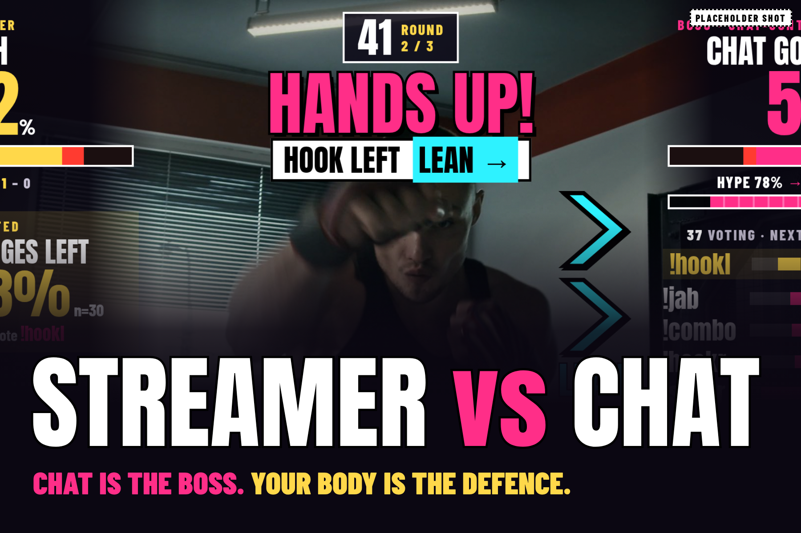
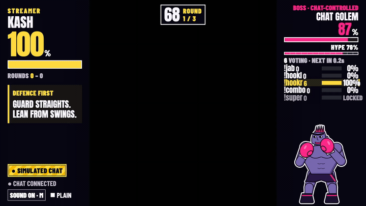
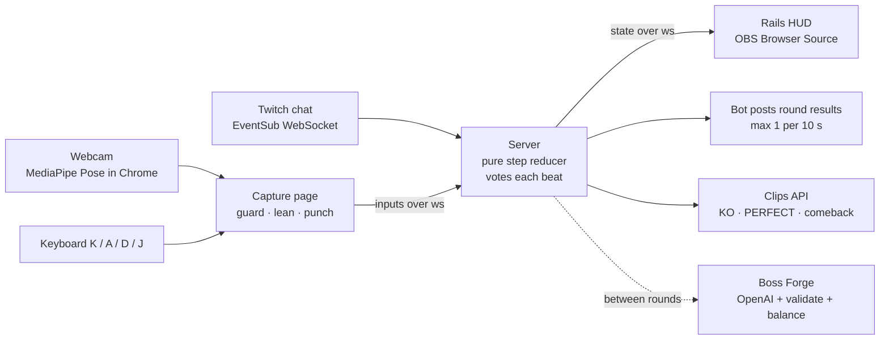

<p align="center"></p>

<h3 align="center">Twitch chat is the boss's brain. Your body is the defence.</h3>

<p align="center">Chat votes the boss's next attack; you choose the difficulty. You block with your hands and dodge with a lean, on webcam, live.</p>

<p align="center">
  <a href="https://streamervschat.kashifnazir.com"><b>Play now, no login</b></a> ·
  <a href="https://streamervschat.kashifnazir.com/play"><b>Try it on your channel</b></a> ·
  <a href="[VIDEO_URL]"><b>3-min demo</b></a> ·
  <a href="[DEVPOST_URL]"><b>Devpost</b></a>
</p>

<p align="center"></p>

<p align="center">
  <a href="https://streamervschat.kashifnazir.com"></a>
</p>
<p align="center">
  <a href="#how-codex-built-this"></a>
  <a href="#how-it-works"></a>
  <a href="#how-it-works"></a>
  <a href="package.json"></a>
  <a href="#tests-and-balance"></a>
  <a href="LICENSE"></a>
</p>

**Codex × TwitchCon Hackathon** · built solo in one Codex thread, October 2026 · Codex session ID `01a17e04-f4f0-7d12-ac96-ff47bf3cc88f`

**Built with** OpenAI Codex · Twitch EventSub, Helix and Clips (Twurple) · MediaPipe Pose Landmarker · Node 22 + TypeScript · OBS · Cloudflare Workers

Most chat games ask chat to spam and the streamer to watch. Here chat runs the boss and the streamer has to physically survive it. The game also learns habits on both sides: it tells chat "DODGES LEFT 83%", and it tells the streamer what chat keeps voting. So chat stops spamming and starts coaching. One viewer is enough to play.

| Headline result | |
|---|---|
| Hard casual player win rate, 0 to 500 viewers (4,000 rounds per cell, gate is 30–70%) | **54.7–70.0%** |
| Hard no-punch player win rate (gate is at least 30%) | **39.7–57.4%** |
| 1,000 simulated chatters: chat to HUD | **p95 104 ms**, 12 ms worst beat drift, 0 dropped votes ([LOAD.md](docs/LOAD.md)) |
| Offline tests (unit, golden vectors, recorded pose clips, transports) | **642**, no Twitch or external network |

## How to play

Chat Golem commands (first word, case-insensitive): **!jab (!j)** = guard; **!left (!l)** = hook from the left → **LEAN →**; **!right (!r)** = hook from the right → **← LEAN**; **!combo (!c)** = guard; **!super (!s)** = follow all three displayed GUARD / LEAN steps, only at full hype. Custom Forge bosses use exactly their displayed commands. Keyboard K / A / D / J controls the streamer.

### Try it in 60 seconds

1. Open **[streamervschat.kashifnazir.com](https://streamervschat.kashifnazir.com)**. No account, no install; it keeps working offline once loaded.
2. Choose **Standing** or **Seated**, optionally **No punches**, and tick **My space is clear and I can move comfortably.** Follow the tutorial: **K → A → J** (or **K → A → D** with no punches). Difficulty starts at **Medium**; the control below the game offers Easy / Medium / Hard / Expert. Webcam is optional.
3. Simulated chat (badged **SIMULATED**) plays the boss. When **HANDS UP!** appears you have 1.0 s on Medium: guard a JAB or COMBO, lean right for HOOK L, left for HOOK R. SUPER has a longer warning and three highlighted guard/lean steps. Hard retains the original 0.8 s warning. Clean defences fill **FOCUS**. At **FINISHER READY**, hold **K** (guard) continuously for **1 s** in a gap between attacks: the FINISHER deals **4 damage**, then gives **3 s** of double-damage bonus punches. It works with no punches too; attacks keep their normal schedule.
4. In round 2, **scouting cards** appear when there is enough consistent evidence: your lean habit on the left rail for chat, chat's repeated move on the right rail for you.

Judges: [JUDGES.md](JUDGES.md) has a five-minute tour, what is live versus simulated, and the known limits.

## Why it's different

- **Your body is the controller, but only where it's reliable.** Guard and lean decide every hit; punches are bonus damage, because on unseen people punch detection was much less reliable than guard and lean. Keyboard, seated and no-punch modes play the same game.
- **Two-way scouting.** From round 2, at least 12 successful dodge leans plus share and confidence bounds can reveal your dominant side to chat. Fix the habit and you heal. Chat gets read too: pre-hold the right defence against chat's favourite move for +25% counter damage and **READ IT**.
- **Balanced by a gate, not a feeling.** Every change runs the same reducer through 4,000-round simulations per cell at 0, 3, 50 and 500 viewers, and CI fails if a Hard casual player's win rate leaves 30–70%. A feature that broke the gate (CHAT SYNC) was cut, not tuned around ([review](docs/queue11a-review.md)).
- **Chat designs the next boss.** `!forge <idea>` asks OpenAI for a boss, and code validates, moderates and balance-tests it before it can fight ([Boss Forge](#boss-forge)).
- **Safe on stream.** A clear-space check before every match. Esc / STOP or the broadcaster typing "stop" freezes play, and mods can `!pause` or `!veto`. Viewer memory stores no chat text, and `!forgetme` deletes a viewer's record.

## How it works



In the local Node/OBS flow, the server owns all game state; the HUD is a view and capture supplies inputs. The no-login demo and hosted `/play` own state in the browser. The same pure `step(state, event, now)` reducer runs in the server, the balance sim, the no-login demo and the hosted `/play` page, so what judges play is what streamers run.

| Mode | Chat | Needs |
|---|---|---|
| No-login demo | Simulated, badged | A browser |
| [Try it on your channel](https://streamervschat.kashifnazir.com/play) | Your real Twitch chat (read only) | A Twitch login |
| Local live + OBS | Real chat, bot posts results, clips, viewer memory, Boss Forge | Node 22, a Twitch app, two accounts; optional OpenAI key for generated bosses |

## Results

Hard balance was rerun for this ship pass. Load and soak figures are recomputed from the saved 28 October local measurements, not fresh physical measurements. [Difficulty results](SPEC.md#13-difficulty-levels) cover all four levels.

| What | Result |
|---|---|
| Hard casual win rate across 0/3/50/500 viewers, ordinary and coordinated chat, rounds 1 and 2 | **54.7–70.0%** |
| Hard no-punch win rate, same matrices | **39.7–57.4%** |
| Golden vectors through the shared reducer | **59** |
| 1,000-chatter load: ingest to HUD p95 / worst beat drift / dropped votes | **104 ms / 12 ms / 0** |
| 30-minute soak: server heap growth after warm-up | **+6.3182%** (gate under 20%) (measured 28 October; recomputed from the saved heap samples) |

How each number is produced, and the command that reruns it: [Tests and balance](#tests-and-balance), [LOAD.md](docs/LOAD.md), [Ship review](docs/queue13e-review.md).

## Run it locally

Needs Node **22.12+**, npm and Chrome. The Twitch steps also need the [Twitch CLI](https://dev.twitch.tv/docs/cli/).

```sh
npm ci
npm run demo          # no-login demo on http://localhost:4173, no keys, no network
npm run dev:mock      # stop demo first; full stack with local mocked Twitch
```

For your own live channel: copy `.env.example` to `.env`, register `http://localhost:3000/callback` on a Twitch app, run `npm run dev`, open http://localhost:3000/auth and authorise a bot account (`user:read:chat user:write:chat user:bot`) and your broadcaster account (`channel:bot clips:edit bits:read channel:read:subscriptions`). Open http://localhost:5173/capture in Chrome, tick clear space, then press **Resume inputs** before **START MATCH**. Add http://localhost:5173/overlay as a 1920×1080 OBS Browser Source over your webcam. Full steps, OBS setup and the mock commands: [docs/DEVELOPMENT.md](docs/DEVELOPMENT.md).

### Tests and balance

```sh
npm test              # offline; never calls Twitch or OpenAI
npm run sim           # balance gate, 4,000 rounds per cell
npx tsc --noEmit
npm run build:demo    # static no-login build in dist-demo/
```

GitHub Actions runs all four plus a two-minute local soak on every push.

## Boss Forge

In the no-login demo, open **Boss Forge**, pick one of four prebaked bosses—Neon Kraken, Tin Tactician, Velvet Sentinel or **Nak Muay** (Muay Thai)—or edit its JSON, then **Validate & balance**. It runs locally with no key. On a live channel, chat sends `!forge <idea>`; the server asks OpenAI (`gpt-6-luna`, one repair turn) with `OPENAI_API_KEY` from `.env`, then validation, moderation and the balance gate decide whether the boss can fight. Ideas never reach the announcer's voice. Details: [docs/boss-forge-review.md](docs/boss-forge-review.md).

## How Codex built this

| | |
|---|---|
| Main Codex thread (submit this ID) | `01a17e04-f4f0-7d12-ac96-ff47bf3cc88f` |
| Commits on `main`, all written in that thread | **31** at the pre-ship snapshot `4b20fb2` |
| Tests over the build | 19 on day 1 → **642** at ship |
| How the work was split | One root thread with subagent lanes for the engine, Twitch/server and HUD, plus an independent subagent review before each commit |

What the live tests and reviews caught, each fixed in the thread:
1. **Guard flickered while leaning**: on stream every lean would have dropped the block. Fixed with a lean-invariant guard and hysteresis (`0c75cd7`, `3c7a268`).
2. **Hands resting at the waist read as guard**: a streamer at rest would have blocked everything. Fixed with an anatomical wrist/elbow/torso gate (`0f7707f`).
3. **CHAT SYNC failed the balance gate in both tuning attempts**, so it was removed rather than loosening the gate ([review](docs/queue11a-review.md)).

`AGENTS.md` holds the rules Codex followed (server owns state, no real Twitch in tests, pose changes need a recorded-clip test). Findings and checks are in the linked day and queue review documents.

## Known limits

- **Punches are optional bonus damage.** Punch detection is less reliable on unseen bodies than guard and lean; no-punch mode keeps automatic defence counters.
- **Camera needs Chrome**, not the OBS Browser Source, and decent light; lost tracking releases held pose inputs.
- **`/play` only reads chat.** Posting results, clips, viewer memory and Boss Forge need the local server.
- **Clips need a live stream at least 60 seconds old**; otherwise the session card shows stats or a local replay.
- **Boss Forge's real-model path needs your own OpenAI key**; the tests use injected fake clients.

## More

- **Rules and numbers:** [SPEC.md](SPEC.md). **HUD layout:** [docs/HUD.md](docs/HUD.md).
- **Developer guide** (OBS, mock Twitch, live chat, highlights, viewer memory, hardening): [docs/DEVELOPMENT.md](docs/DEVELOPMENT.md).
- **Accessibility:** keyboard, seated and no-punch modes, a 36 px HUD font floor, calm FX (`?fx=calm` or reduced motion), sound off by default ([day 5](docs/day5-review.md), [day 6](docs/day6-review.md)).
- **Assets and licences:** [CREDITS.md](CREDITS.md).

## What's next

- **More fighting styles with the same detection.** Boss data supplies names, timing and damage within the validator and balance gates; detection stays guard, lean left, lean right and either lean. Nak Muay already adds TEEP, LEFT ELBOW, RIGHT ELBOW and CLINCH KNEES using those same reads; more styles can follow without new detection.
- **Other games on the same body input:** dodgeball, rhythm or fitness rounds where chat sets the pattern and the streamer moves to it.
- **A Twitch Extension** so viewers vote by clicking the video instead of typing (future work).

## Licence

MIT for the code: see [LICENSE](LICENSE). Fonts, sounds, art and voice lines keep their own licences, listed per file in [CREDITS.md](CREDITS.md).
