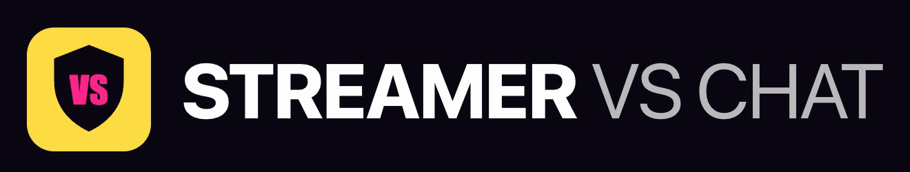
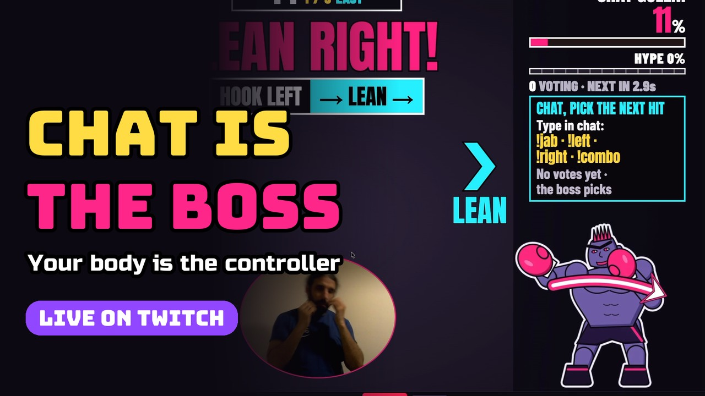
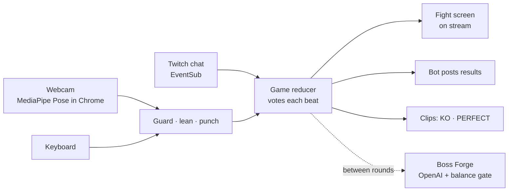

<p align="center"></p>

<h3 align="center">Twitch chat is the boss's brain. Your body is the controller.</h3>

<p align="center">Chat votes the boss's next attack, or calls the combo you throw. You guard, lean and punch on your webcam, live on stream.</p>

<p align="center">
  <a href="https://streamervschat.kashifnazir.com"><b>Play now, no login</b></a> ·
  <a href="https://streamervschat.kashifnazir.com/play"><b>Play on your channel</b></a> ·
  <a href="https://youtu.be/d1ZewiNJvbE"><b>3-min demo</b></a> ·
  <a href="https://twitchcon-codex.devpost.com"><b>Hackathon</b></a>
</p>

<p align="center"><a href="https://youtu.be/d1ZewiNJvbE"></a></p>

<p align="center">
  <a href="https://streamervschat.kashifnazir.com"></a>
</p>
<p align="center">
  <a href="#how-codex-built-this"></a>
  <a href="#how-it-works"></a>
  <a href="docs/WEBCAM.md"></a>
  <a href="package.json"></a>
  <a href="docs/HOSTED.md"></a>
  <a href="#tests"></a>
  <a href="LICENSE"></a>
</p>

**Codex × TwitchCon Hackathon** · built solo by Kash with OpenAI Codex · Codex session ID `01a17e04-f4f0-7d12-ac96-ff47bf3cc88f`

Chat runs the boss and the streamer has to physically survive it. Every beat, viewers vote the next attack; a callout names the defence, and the streamer blocks with their hands or leans away, on an ordinary webcam. In **Crowd Trainer**, chat calls boxing combos instead and the streamer throws them. One viewer is enough to play.

| Headline result | |
|---|---|
| Live on twitch.tv/kashruns, 2 November | the bot posted round results and KO / PERFECT clips; chat forged **The Vermicelli Vortex** and it fought the next round |
| Offline tests, `npm test` | **1,281**, no Twitch or network needed |
| Simulated 1,000-chatter load, chat to screen | **p95 104 ms**, 0 dropped votes ([LOAD.md](docs/LOAD.md)) |
| Balance gate, 0 to 500 simulated viewers | casual win rate held at **30–70%** in every case |
| Fast one-two punches, Kash's webcam drills | **51 of 59** caught, 0 false punches while guarding and leaning |

<p align="center"></p>

### Try it in 60 seconds

1. Open **[streamervschat.kashifnazir.com](https://streamervschat.kashifnazir.com)**. No account, no install.
2. In **Try it now**, pick **Webcam** (a 30-second setup) or **Keyboard** (K guard, A/D lean, J punch), then **TRY THE DEMO**. Simulated chat plays the boss, always badged SIMULATED.
3. Try **[Crowd Trainer](https://streamervschat.kashifnazir.com/?mode=trainer)**, or go live for real at **[/play](https://streamervschat.kashifnazir.com/play)**: connect Twitch in Chrome, go live straight from the page (or use OBS), and your chat plays.

Judges: [JUDGES.md](JUDGES.md) has a 90-second path, what is live and what is simulated, and the five-minute tour.

## Two ways to play

| | Chat types | You do |
|---|---|---|
| **Boss Fight** | `!jab` / `!combo` · `!left` · `!right` · `!super` at full hype (or `!j` `!c` `!l` `!r` `!s`) | **Guard** · **lean right** · **lean left** · follow the 3 SUPER steps |
| **Crowd Trainer** | `!12`, `!112`, `!121`, `!1212`, `!12s`, `!s12`, `!12g`, `!2s2`, `!faster`, `!slower` | Throw the combo: **1** lead hand, **2** rear hand, **S** slip, **G** guard |

The most-voted move wins each beat, so more viewers means more say. Boss Fight is the fun one anyone can use; Crowd Trainer is the workout: three 60-second rounds, a coach voice calling each combo, and CLEAN / PARTIAL / MISSED scoring.

## Why it's different

- **Chat is the opponent's brain, not a remote control.** Twitch Plays-style games let chat control the game, and Crowd Control lets chat trigger effects in someone else's game. Here chat plays against the streamer, and the streamer's body is the controller (our framing).
- **Both sides scout each other.** From round 2, chat sees the streamer's habit ("DODGES LEFT 83%") and the streamer sees chat's favourite move, so chat stops spamming and starts coaching.
- **Chat can build the boss.** With **Boss Forge**, viewers type `!forge` and an idea; the game drafts the boss, checks it's a fair fight with the balance gate, and it fights the next round.
- **Built for the stream.** The bot posts each result to chat, KOs and perfect rounds become Twitch clips, mods can `!pause` and `!veto`, and `!forgetme` deletes a viewer's record.

## How it works



One pure game reducer runs everywhere: the local server, the balance simulator, the no-login demo and hosted `/play`, so what judges play is what streamers run. A Cloudflare Worker hosts the chat bot, clips, Boss Forge and opt-in viewer memory ([HOSTED.md](docs/HOSTED.md)).

## What a webcam can do

Any ordinary webcam in Chrome is enough: no gloves, sensors or depth camera. Pose runs in the browser, and frames never go to a server.

| | Result on Kash's webcam |
|---|---|
| **Guard** | held through leans on every recorded frame |
| **Lean** | shallow leans 6 of 6, fight-speed leans 16 of 16, 0 false leans ([test](test/pose/shallow-lean.test.ts)) |
| **Straight punches** | 42 of 44 recorded punches, and 51 of 59 in fast one-two drills ([test](test/pose/straight-punch.test.ts)) |

So guard and lean decide every hit, and punches add bonus damage. Punches read best slightly exaggerated, a little upward rather than straight at the lens. Evidence, and what better hardware could add: [WEBCAM.md](docs/WEBCAM.md).

## Live on Twitch

- **First test, with a friend typing as chat (29 October).** In Kash's words: "They really enjoyed the concept, and they found it engaging enough to watch. They liked making me move around, especially because it was very quick." It was too fast to keep up with, so the game got four difficulty levels; the next session added one-letter commands, clearer hit feedback and a visible SUPER sequence.
- **Setup (31 October).** OBS took half an hour, so the page can now go live on its own: share the tab and only the fight screen goes on stream.
- **Full run (2 November, kashruns).** Chat votes, bot results, clips, a forged boss and Crowd Trainer, all live: it's the footage in the [demo video](https://youtu.be/d1ZewiNJvbE).

## How Codex built this

Built with OpenAI Codex, in one main thread: 77 turns and 57 code commits. Kash set the direction, approved every brief and did all the camera and Twitch testing. Codex planned each task, split the work across subagents running in parallel, tested it in browsers, reviewed each commit with an independent subagent and wrote the code ([AGENTS.md](AGENTS.md)).

In Kash's words:

> I wish I had Pro, but I wanted to build this with Codex, as I've used it for other stuff in the past and at an OpenAI hackathon a few weeks ago, and enjoyed using it. I went through all of my credits from an OpenAI hackathon, I did a full-week reset as well, and I only stopped using it because I'd got down to my last 4%.
>
> I really enjoy using Codex, and it helped me in three ways:
> 1. You can see what's going on. Especially in the Codex app, you can see how it opens test browsers, and the IDE comes up so you can see the editor.
> 2. The connection to my phone: I did the testing myself, and I was able to run it from elsewhere.
> 3. The cloud instances, which I found super helpful, and using as many subagents in parallel as we needed to get this moving.

**Calls Codex made itself:** when the balance gate rejected the briefed 8-damage FINISHER (72.6% > 70%), it cut it to 4 instead of loosening the gate ([tests](test/engine/focus-finisher.test.ts)); it dropped CHAT SYNC after two tuning attempts failed the gate; and after live tests it made the guard hold through leans and stopped resting hands counting as a guard ([replay tests](test/pose/replay.test.ts)).

**Finished with Claude Code.** After the last Codex turn, the final fixes from live tests and the Crowd Trainer mode were made with Claude Code. Every one of those commits is labelled "(Claude Code)": [full list and split](docs/codex-evidence.md#claude-code-commits).

## Run it locally

Needs Node **22.12+**, npm and Chrome.

```sh
npm ci
npm run demo          # no-login demo on http://localhost:4173, no keys, no network
npm run dev:mock      # full stack against a local mock of Twitch (needs the Twitch CLI)
```

Your own live channel (Twitch app, `.env`, bot account, OBS overlay): [DEVELOPMENT.md](docs/DEVELOPMENT.md).

### Tests

```sh
npm test              # 1,281 offline tests; never calls Twitch or OpenAI
npm run sim           # balance gate, 4,000 simulated rounds per case
npx tsc --noEmit
npm run build:demo    # the static no-login build
```

GitHub Actions runs all four on every push. Balance numbers come from assumed player models, not human win rates ([SPEC](SPEC.md#13-difficulty-levels)).

## Good to know

- **Webcam play starts on Easy** (1.2 s to react); keyboard, seated and no-punch modes are there for anyone who can't or won't use a camera or punch.
- **Going live from the page** uses Twitch's WHIP ingest; it worked live on kashruns, and OBS is the documented route for full control.
- **Hosted extras** (the bot, clips, Boss Forge, viewer memory) are switched on at streamervschat.kashifnazir.com; to run them yourself you need your own Twitch app and an OpenAI key, never a viewer's.
- **Not related to the Steam game of the same name** ([an unreleased arena shooter](https://store.steampowered.com/app/4377330)).

## More

- [SPEC.md](SPEC.md) (rules and numbers) · [JUDGES.md](JUDGES.md) · [WEBCAM.md](docs/WEBCAM.md) · [HOSTED.md](docs/HOSTED.md) · [DEVELOPMENT.md](docs/DEVELOPMENT.md) · [Codex evidence](docs/codex-evidence.md) · [CREDITS.md](CREDITS.md)
- **Accessibility:** keyboard, seated and no-punch modes, large HUD text, a focus-trapped pause menu and calm effects (`?fx=calm` or reduced motion).
- **What's next**, in Kash's words: better calibration "so that this could work purely off video", more types of punches, and kicks if there's space: "If there's more space, I like to do more Thai with kicks." Also more fighting styles on the same guard and lean detection (Nak Muay already adds teep, elbows and clinch) and a Twitch Extension so viewers can vote by clicking.

## Licence

MIT for the code ([LICENSE](LICENSE)). Fonts, sounds, art and voice lines keep their own licences ([CREDITS.md](CREDITS.md)).
